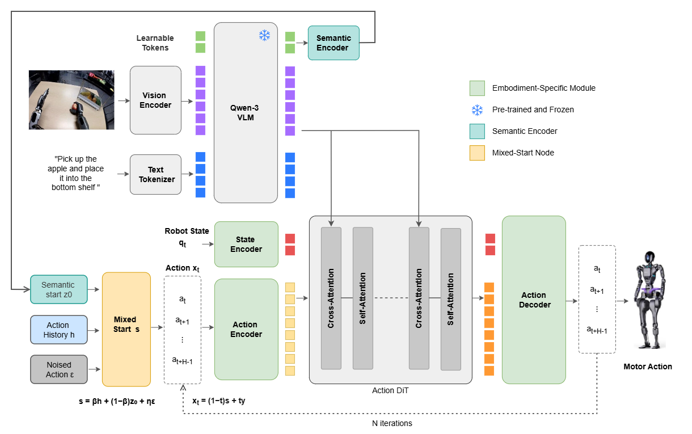
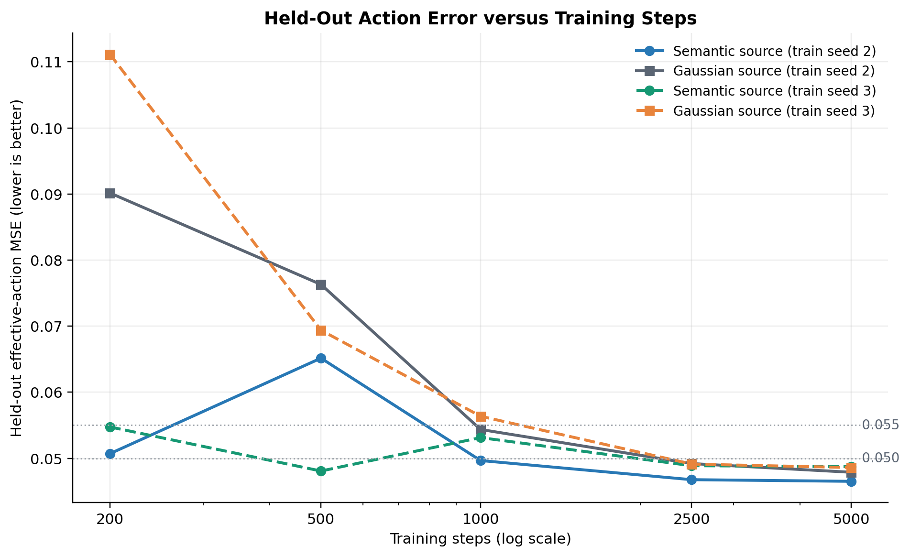
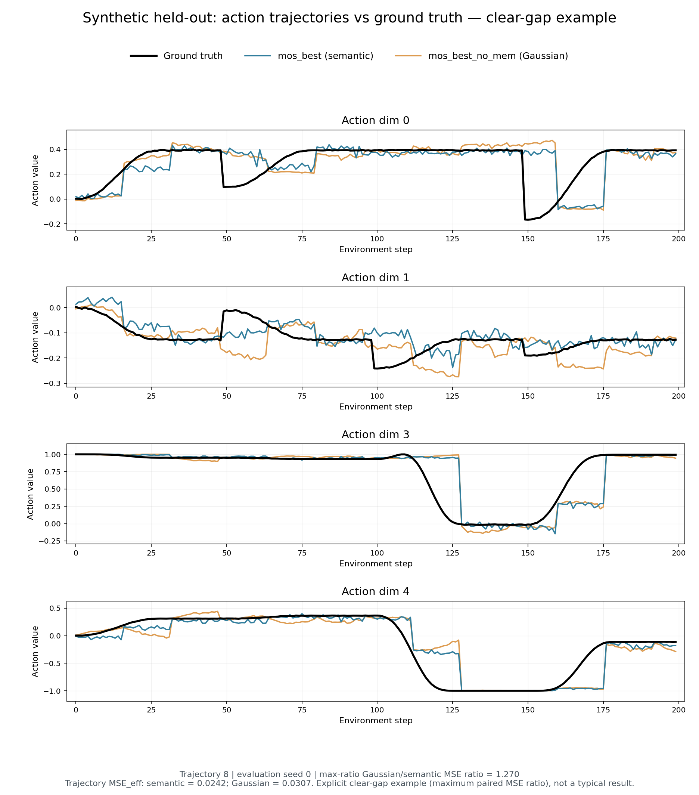
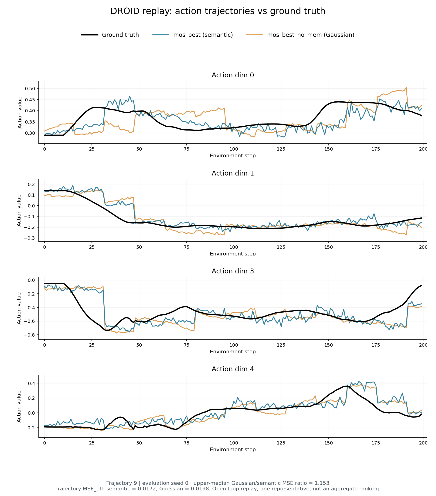

# MoS：基于混合起点的流匹配动作生成

[](README.md)
[](paper/Mixed-Start_Flow_Matching_for_Action_Generation_v1.pdf)
[](https://www.modelscope.cn/models/joyogzw/GR00T-N1.7-MixedStart)

MoS 在 GR00T N1.7-3B 上研究流匹配动作源的**条件内容**与**随机性**：可学习查询从冻结 VLM 读取语义特征，经 MLP 生成语义起点 `z₀`；训练时构造 `s = βh + (1 − β)z₀ + ηε`，其中 `β ~ U(0, 0.3)`、`η = 0.04`，并使用混合源一致性损失。部署时 `β = 0` 关闭历史混合，`η = 0` 进一步消除源采样随机性。

## 📣 动态

- **2026-10-31**：发布 `mos_best`、`mos_best_no_mem` 两组权重及配套代码、数据和论文。

## 🧩 三项核心贡献

1. **条件语义起点编码器**：`K = 64` 个查询经冻结 VLM 和 MLP 产生动作块形状的 `z₀`；它只作为流起点，不作为额外 DiT token。
2. **训练混合、部署纯语义**：历史窗采用严格过去对齐 shift/1；混合源一致性损失避免直接回归目标动作造成的监督冲突。
3. **分离内容与随机性的评估**：多种子、等噪声预算、零噪声和固定噪声对照，联合报告动作精度与 repeat divergence。

## 🏗️ 模型架构



冻结的 Cosmos-Reason2-2B（Qwen3-VL）处理图像、指令与可学习查询，MLP 将查询特征映射为语义起点 `z₀`。训练时使用 `s = βh + (1 − β)z₀ + ηε` 和混合源一致性损失，Action DiT 学习从源到目标动作块的速度场。部署默认 `β = 0`；另设 `η = 0` 才得到完全确定的语义源。数学定义见[论文](paper/Mixed-Start_Flow_Matching_for_Action_Generation_v1.pdf)，发布默认参数见[模型卡](release/README.md)。

## 📦 模型与资源

| 资源 | 链接或目录 |
|---|---|
| 语义起点权重 | `release/mos_best` |
| 高斯源对照权重 | `release/mos_best_no_mem` |
| 模型仓库 | [ModelScope 模型](https://www.modelscope.cn/models/joyogzw/GR00T-N1.7-MixedStart) |
| 数据集仓库 | [ModelScope 数据集](https://www.modelscope.cn/datasets/joyogzw/GR00T-N1.7-MixedStart-Datasets) |
| 源码与复现 | [GitHub](https://github.com/GUOZHIWEN/GR00T-N1.7-MixedStart) · [复现指南](docs/REPRODUCE.md) |

两组发布模型均从**预训练 Action DiT**微调；论文多种子主结果使用**从零初始化 DiT**，两条证据线不能混用。

## 📊 发布权重的开环结果

**表 1｜发布权重开环结果，指标越低越好。** 配对比值为 `mean(Gaussian_i / Semantic_i)`，大于 1 表示语义臂更优。

| 数据域 | 指标 ↓ | `mos_best` | `mos_best_no_mem` | 高斯／语义配对比值［95% CI］ |
|---|---|---:|---:|---:|
| 合成 held-out | 有效动作 MSE | **0.0471** | 0.0560 | **1.33［1.04，1.60］** |
| 合成 held-out | repeat divergence | **0.0220** | 0.0644 | **3.00［2.71，3.31］** |
| DROID replay | 有效动作 MSE | 0.0174 | **0.0165** | 0.97［0.81，1.14］，无显著差异 |
| DROID replay | repeat divergence | **0.0206** | 0.0432 | **2.10［1.90，2.27］** |

发布模型使用 100 条合成＋300 条 DROID episode、17D 状态／动作、5000 步和训练 seed 2。所有结果均为开环 replay；repeat divergence 不是闭环成功率。DROID 上未观察到显著精度提升，也不据此宣称真机部署收益。

## 📈 从零初始化 DiT 的动作轨迹对比

以下结果均属于**从零初始化 DiT**，与上一节发布权重的预训练 DiT 微调结果分开解读。

**表 2｜三个训练随机种子的精度与运行间可重复性。**

| 指标 | 合成域 | DROID replay |
|---|---:|---:|
| repeat divergence 配对比值 | **2.80［2.66，2.95］** | **2.04［1.95，2.15］** |
| 有效动作 MSE 配对比值 | **1.12［1.06，1.18］** | **1.20［1.10，1.30］** |

注：括号内为 95% cluster bootstrap 置信区间；比值为高斯源／语义源，大于 1 有利于语义源。



**开环 heldout 精度随训练步数变化。** 两个训练随机种子的独立配对均显示，语义源在早期 checkpoint 上更快达到可用精度。达阈步数是离散 checkpoint 的首达点，曲线并非严格单调；结论基于开环部署指标，不代表墙钟加速。

### 动作轨迹对比

下图在相同留出轨迹上对比**语义起点模型**与**高斯起点模型**的动作预测，每个动作维度同时画出真值与两个模型的输出。两者均使用**从零初始化的 Action DiT、训练随机种子 2 和 5000 步 checkpoint**；这里展示开环 replay，不是发布权重的预训练 DiT 微调结果。

**合成 held-out｜清晰差异示例，轨迹 8**



该轨迹的有效动作 MSE：语义臂为 **0.0242**，高斯臂为 **0.0307**。此图按同一评估 seed 0 的 10 条轨迹中最大“高斯／语义 MSE 比”选出，动作维度仍固定为 0、1、3、4。它仅展示**部分案例**；整体结论仍以多种子配对统计为准。

**DROID replay｜代表轨迹 9**



该轨迹的有效动作 MSE：语义臂为 **0.0172**，高斯臂为 **0.0198**，此示例语义臂更低。固定动作维度和公开的轨迹选择规则保证图片可复核；单条轨迹不能替代配对统计。双臂推理与绘图命令见[复现指南](docs/REPRODUCE.md#101-readme-trajectory-figures)。

## 🚀 快速开始

### 📥 发布权重训练与评估

```bash
git clone https://github.com/GUOZHIWEN/GR00T-N1.7-MixedStart.git
cd GR00T-N1.7-MixedStart
pip install uv && uv sync
uv pip install modelscope

# 固定版本下载、SHA256 校验并解包数据
uv run python scripts/prepare_mos_data.py --output-dir data

# 发布权重冒烟训练：双臂各 200 步
BASE_MODEL_PATH=/path/to/GR00T-N1.7-3B \
  bash scripts/train_mos_release.sh both smoke 2

# 正式训练与完整开环评估
BASE_MODEL_PATH=/path/to/GR00T-N1.7-3B \
  bash scripts/train_mos_release.sh both final 2
bash scripts/eval_mos_release.sh all 2

# 导出可加载发布目录并做结构校验
uv run python scripts/export_mos_release.py --run-suffix _v2 --output-dir release
uv run python scripts/validate_mos_release.py --release-dir release --write-sums
```

### 🤖 只做推理

```bash
modelscope download --model joyogzw/GR00T-N1.7-MixedStart --local_dir release
uv run python examples/mos_inference.py \
  --model-path release/mos_best --sample-npz examples/real_observation.npz \
  --task "indicate all the blocks one after another" \
  --device cuda --denoising-steps 4 --fixed-beta 0 --fixed-noise-std 0 \
  --history-replan-stride 16 --output runs/mos_inference_action.npz
```

附带的 `examples/real_observation.npz` 是**合成评估集**的真实解码观测，不是随机模板或实机采集；来源 JSON 同步提供。轨迹 NPZ 保存动作输出，不能作为模型输入。输入 NPZ 契约、反归一化输出、历史缓冲与 reset 规则见 [推理说明](docs/INFERENCE.md)。

## 🗂️ 仓库结构

```text
MoS/
├── gr00t/                  # 完整可运行源码，含 MoS 训练、评估与推理修改
├── scripts/                # 数据、训练、评估、聚合、导出和校验脚本
├── examples/               # 最小单样本推理
├── tests/                  # 核心单元测试
├── docs/                   # 复现、模型、数据、推理和版本材料
│   └── history/            # 历史实验台账，不是当前复现入口
├── paper/                  # 仅英文论文 PDF
└── release/                # 权威发布模型卡与图片；权重由 ModelScope 下载
```

## ⚠️ 统计口径与限制

配对比值为 `mean(reference_i / candidate_i)`；置信区间使用整轨迹聚类 bootstrap。合成域聚合 4 个评估 seed，DROID 使用评估 seed 0。训练步数达阈速度不等于墙钟加速。

当前验证限于单一 VLA 模型族、DROID 类本体、双视角和开环 replay。跨本体、闭环和真机收益需要另行验证。

## ✒️ 引用

```bibtex
@misc{mos2026mixedstart,
  title  = {Mixed-Start Flow Matching for Action Generation},
  author = {Guo, Zhiwen},
  year   = {2026},
  note   = {arXiv technical report}
}
```

## 📬 联系方式

如有任何问题，请联系：[zhiwenguo99@gmail.com](mailto:zhiwenguo99@gmail.com)

## ⚖️ 许可与致谢

代码采用 [Apache-2.0](LICENSE)。上游和第三方归属见 [ATTRIBUTIONS.md](ATTRIBUTIONS.md)；DROID 数据遵循其原始许可。历史台账已移至 `docs/history/`，不再作为当前模型或复现结论入口。
