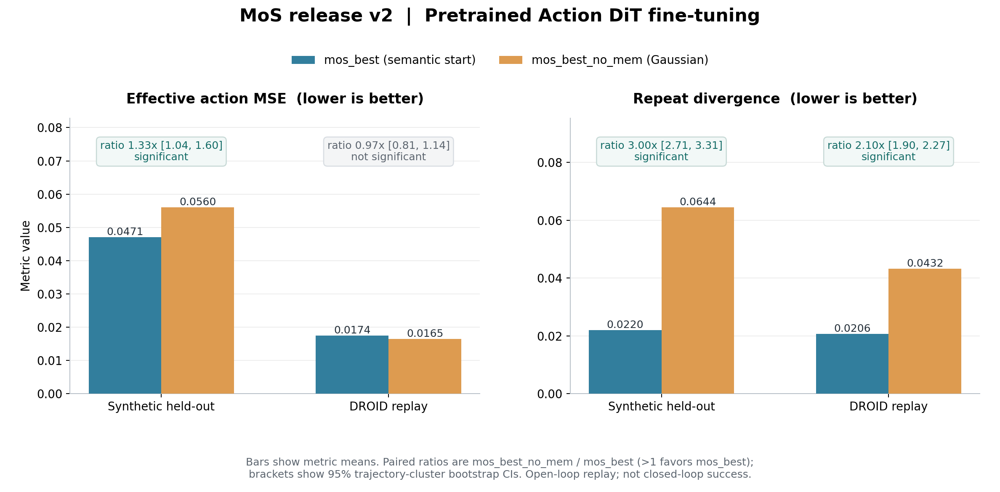
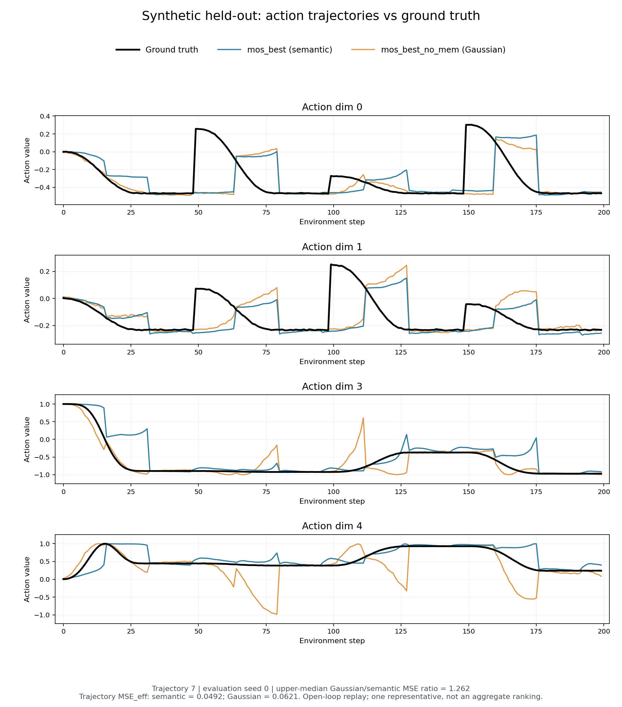
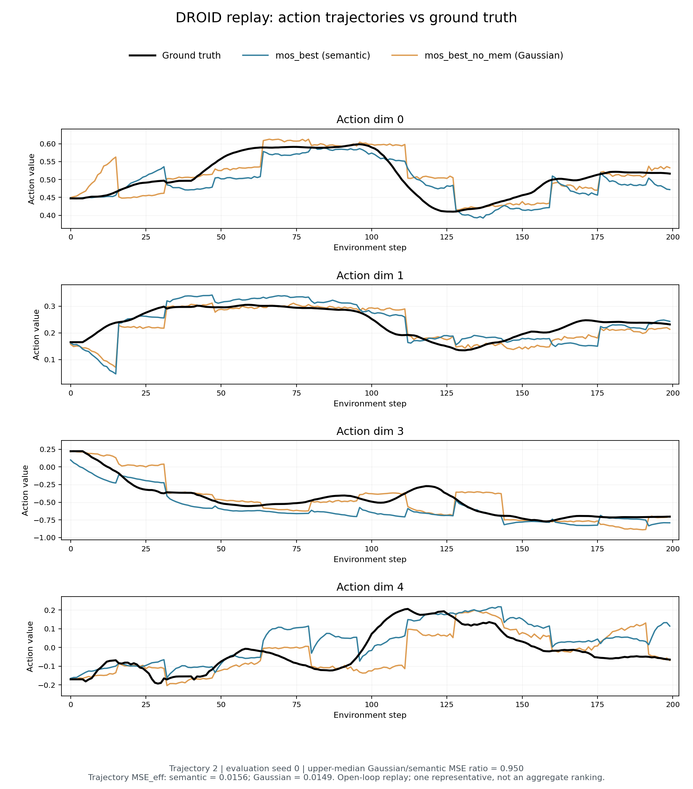

# GR00T-N1.7-MixedStart

MoS（Mixed-Start Flow Matching）是基于 **NVIDIA GR00T N1.7-3B** 的流匹配动作生成模型。`mos_best` 使用条件语义起点，主要改善开环动作输出的可重复性，并在合成 held-out 数据上提高动作精度；`mos_best_no_mem` 是使用相同数据和主要训练配置的高斯源对照。

## 📣 动态

- **2026-10-31**：发布 `mos_best`、`mos_best_no_mem` 两组权重及配套代码、数据和论文。

## 📦 模型与代码

| 资源 | 链接或目录 |
|---|---|
| 语义起点模型 | `release/mos_best` |
| 高斯源对照 | `release/mos_best_no_mem` |
| 完整代码 | [GUOZHIWEN/GR00T-N1.7-MixedStart](https://github.com/GUOZHIWEN/GR00T-N1.7-MixedStart) |
| 模型仓库 | [ModelScope 模型](https://www.modelscope.cn/models/joyogzw/GR00T-N1.7-MixedStart) |
| 数据集仓库 | [ModelScope 数据集](https://www.modelscope.cn/datasets/joyogzw/GR00T-N1.7-MixedStart-Datasets) |

两个模型均从**已预训练的 GR00T Action DiT**继续微调，并非从零初始化 DiT。论文中的多种子主结果属于另一条“从零初始化 DiT”实验线，二者不能混用结论。

## 🏗️ 模型架构


- **冻结 VLM**：Cosmos-Reason2-2B（Qwen3-VL）读取图像、语言指令和可学习查询。
- **语义起点编码器**：MLP 将查询表征映射为动作先验 `z₀`。
- **混合起点**：训练时使用 `s = βh + (1 − β)z₀ + ηε`，其中 `β ~ U(0, 0.3)`、`η = 0.04`；配合混合源一致性损失。
- **动作生成**：Action DiT 学习从起点到目标动作块的速度场，默认 4 步 Euler 解码。
- **部署源**：`β = 0` 只关闭历史混合；另设 `η = 0` 才得到完全确定的语义源。

## 📊 发布权重的开环结果



| 数据域 | 指标 ↓ | `mos_best` | `mos_best_no_mem` | 高斯／语义配对比值［95% CI］ |
|---|---|---:|---:|---:|
| 合成 held-out | 有效动作 MSE | **0.0471** | 0.0560 | **1.33［1.04，1.60］**，显著改善 |
| 合成 held-out | repeat divergence | **0.0220** | 0.0644 | **3.00［2.71，3.31］**，显著改善 |
| DROID replay | 有效动作 MSE | 0.0174 | **0.0165** | 0.97［0.81，1.14］，无显著差异 |
| DROID replay | repeat divergence | **0.0206** | 0.0432 | **2.10［1.90，2.27］**，显著改善 |

两项指标均越低越好。配对比值估计为 `mean(reference_i / candidate_i)`，不是两个总均值相除；95% CI 使用 20,000 次整轨迹聚类 bootstrap。合成域聚合 4 个评估随机种子，DROID 使用评估随机种子 0；每个数据域使用 10 条留出轨迹，训练随机种子为 2。

repeat divergence 衡量相同初始条件下两次独立开环 rollout 的动作分歧，不是闭环成功率。发布结果对应 `η = 0.04`；`η = 0` 是另一项部署对照，使用前应重新验证任务精度。

### 动作轨迹示例

每个动作维度同时展示三条曲线：黑色为真值，蓝色为 `mos_best`，金色为 `mos_best_no_mem`；图例位于绘图区外。代表轨迹按评估随机种子 0 下逐轨迹“高斯／语义 MSE 比”的上中位数选择，动作维度固定为 0、1、3、4，并非最佳案例筛选。

**合成 held-out｜代表轨迹 7**



该轨迹的有效动作 MSE：`mos_best` 为 **0.0492**，`mos_best_no_mem` 为 **0.0621**。语义臂在此示例中误差更低，并减少了高斯臂在部分区段的大幅偏离。

**DROID replay｜代表轨迹 2**



该轨迹的有效动作 MSE：`mos_best` 为 **0.0156**，`mos_best_no_mem` 为 **0.0149**，两者接近且此例高斯臂略低。单条轨迹仅用于直观展示，整体结论仍以配对统计为准；DROID 上未观察到显著精度差异，不应将局部曲线贴合解释为整机精度优势。

## ⚙️ 训练信息

| 项目 | 配置 |
|---|---|
| 基座 | `nvidia/GR00T-N1.7-3B` |
| DiT 初始化 | GR00T 预训练权重，继续微调 |
| 训练数据 | 100 条合成 episode＋300 条 DROID episode |
| 状态／动作 | 17D：EEF 9D＋夹爪 1D＋关节 7D |
| 历史对齐 | 严格过去窗 shift/1 |
| 训练步数 | 5,000 步，训练随机种子 2 |
| 默认解码 | `β = 0`，4 步 Euler，执行窗口与重规划步幅 16 |

5000 步训练墙钟时间分别为：语义臂 3838.98 秒，高斯臂 3120.51 秒。

## 🚀 快速使用

### 1. 获取代码、环境和数据

```bash
git clone https://github.com/GUOZHIWEN/GR00T-N1.7-MixedStart.git
cd GR00T-N1.7-MixedStart
pip install uv
uv sync
uv pip install modelscope

# 按固定 revision 下载、SHA256 校验并解包全部复现数据
uv run python scripts/prepare_mos_data.py --output-dir data

# 仅使用发布权重时下载
modelscope download --model joyogzw/GR00T-N1.7-MixedStart --local_dir release
```

### 2. 最小单样本推理

输入 NPZ 的键、shape 和 dtype 见 [docs/INFERENCE.md](https://github.com/GUOZHIWEN/GR00T-N1.7-MixedStart/blob/main/docs/INFERENCE.md)。代码仓附带 `examples/real_observation.npz` 及来源 JSON，样本来自合成评估集的真实解码观测，不是随机模板或实机采集。以下命令只生成动作预测，不连接或驱动机器人：

```bash
uv run python examples/mos_inference.py \
  --model-path release/mos_best \
  --sample-npz examples/real_observation.npz \
  --task "indicate all the blocks one after another" \
  --device cuda --denoising-steps 4 \
  --fixed-beta 0 --fixed-noise-std 0 \
  --history-replan-stride 16 \
  --output runs/mos_inference_action.npz
```

模型返回已经反归一化的 `action.eef_9d`（40×9）、`action.gripper_position`（40×1）和 `action.joint_position`（40×7）。每个新 episode 必须调用 `policy.reset()`；不要直接执行由模板随机输入产生的动作。

### 3. 开环对比评估

合成域：

```bash
CUDA_VISIBLE_DEVICES=0 uv run python gr00t/eval/compare_flow_sources.py \
  --dataset-path data/synth_mixture_eval_db7_17d \
  --embodiment-tag OXE_DROID_RELATIVE_EEF_RELATIVE_JOINT \
  --model-paths release/mos_best release/mos_best_no_mem \
  --labels mos_best mos_best_no_mem \
  --traj-ids 0 1 2 3 4 5 6 7 8 9 \
  --steps 200 --execution-horizon 16 --denoising-steps 4 \
  --history-source pred --force-fixed-beta --fixed-beta-value 0.0 \
  --segment-meta-path data/synth_mixture_eval_db7_17d/meta/segment_schedule.jsonl \
  --high-level-task-from-meta --seed 0 \
  --out-dir runs/eval_release_synth_es0
```

DROID：

```bash
CUDA_VISIBLE_DEVICES=0 uv run python gr00t/eval/compare_flow_sources.py \
  --dataset-path data/droid_subset_eval \
  --embodiment-tag OXE_DROID_RELATIVE_EEF_RELATIVE_JOINT \
  --model-paths release/mos_best release/mos_best_no_mem \
  --labels mos_best mos_best_no_mem \
  --traj-ids 0 1 2 3 4 5 6 7 8 9 \
  --steps 200 --execution-horizon 16 --denoising-steps 4 \
  --history-source pred --force-fixed-beta --fixed-beta-value 0.0 \
  --seed 0 --out-dir runs/eval_release_droid_es0
```

完整的单臂评估、配对 CI 聚合、训练与导出命令见代码仓 `docs/REPRODUCE.md`。

## ⚠️ 适用范围与局限

- 当前证据来自开环 replay，真机和闭环任务成功率待验证。
- 基座 DiT 微调的 `mos_best` 仅在合成域观察到显著精度收益；DROID 精度差异不显著。
- 模型仅在与训练数据相近的 DROID 本体、双视角和 17D 表示下验证；迁移到其他机器人需要重新标定、训练和评估。

## ✒️ 引用

```bibtex
@misc{mos2026mixedstart,
  title  = {Mixed-Start Flow Matching for Action Generation},
  author = {Guo, Zhiwen},
  year   = {2026},
  note   = {arXiv technical report}
}
```

## ⚖️ 许可证与致谢

代码和本发布材料采用 [Apache License 2.0](LICENSE)。基于 [NVIDIA Isaac-GR00T](https://github.com/NVIDIA/Isaac-GR00T) 与 DROID 数据和本体规范构建。第三方模型、代码、数据及其衍生使用仍需遵循各自原始许可与使用条件；详见代码仓 `ATTRIBUTIONS.md` 和 `docs/DATASET_CARD.md`。
